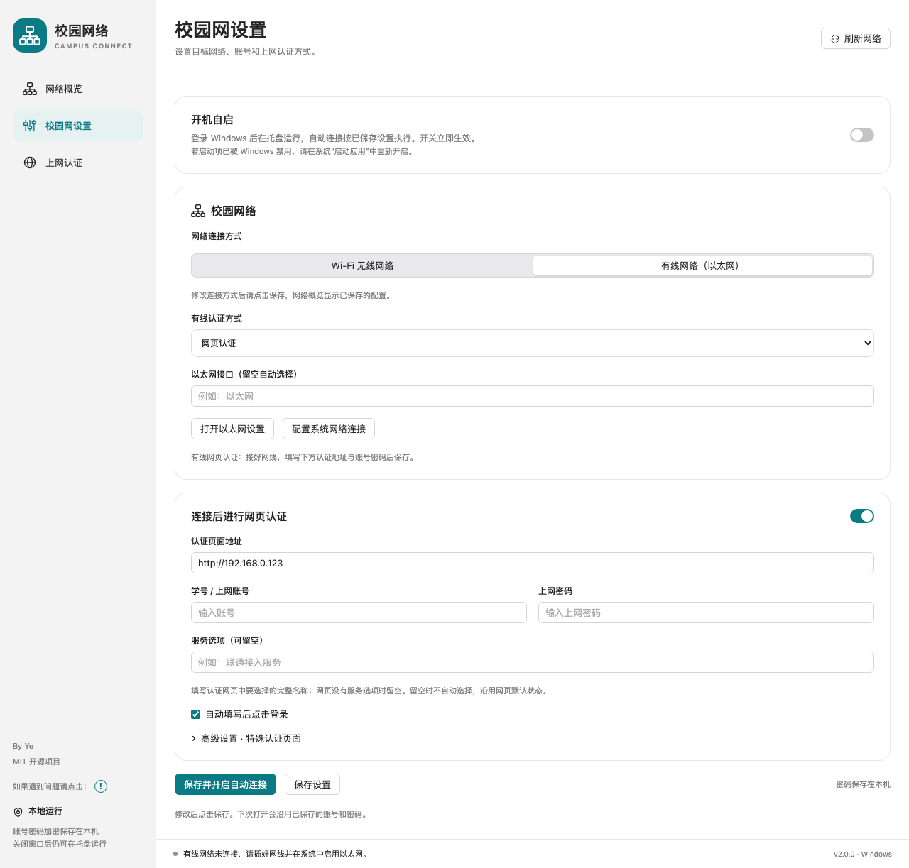
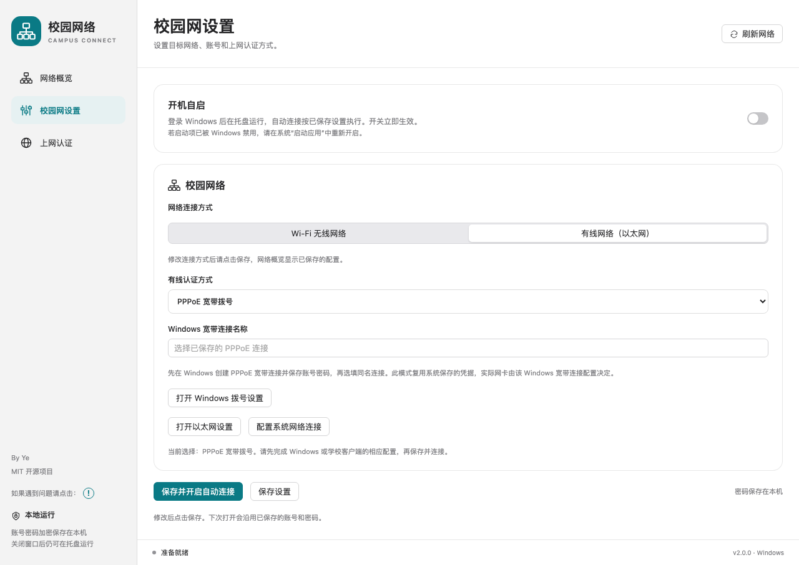
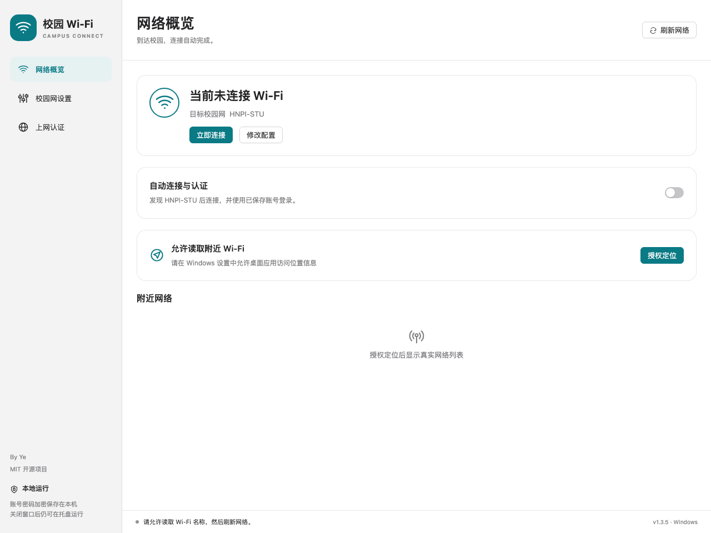
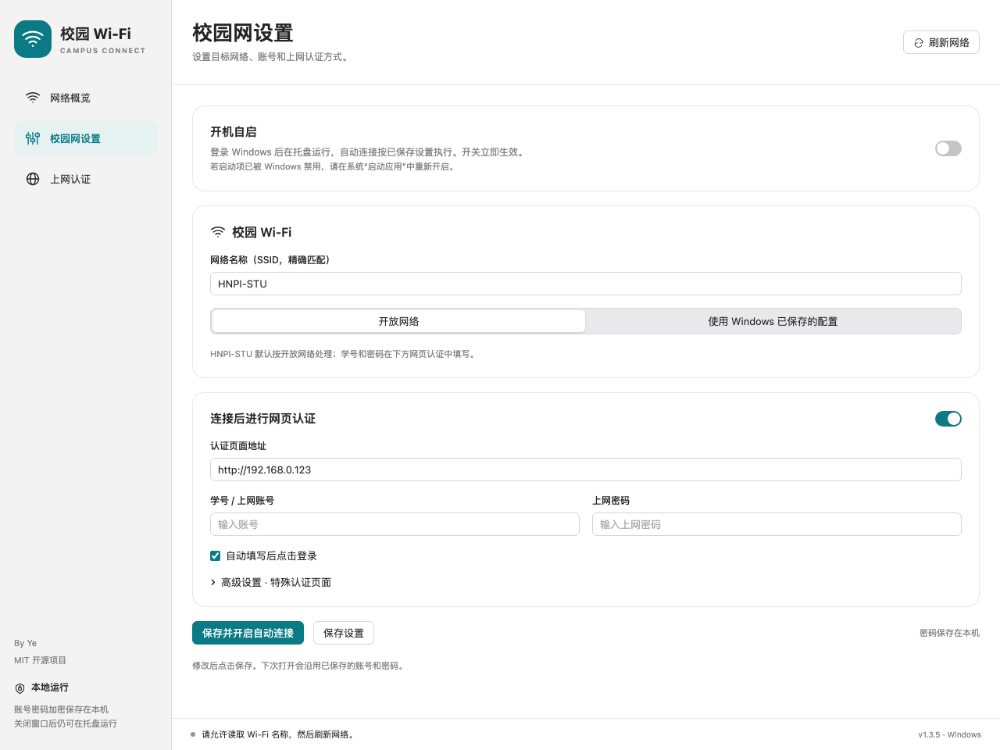
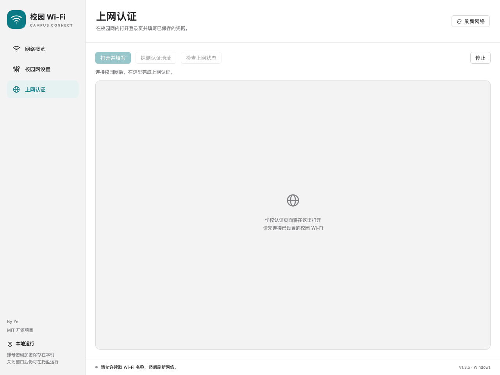
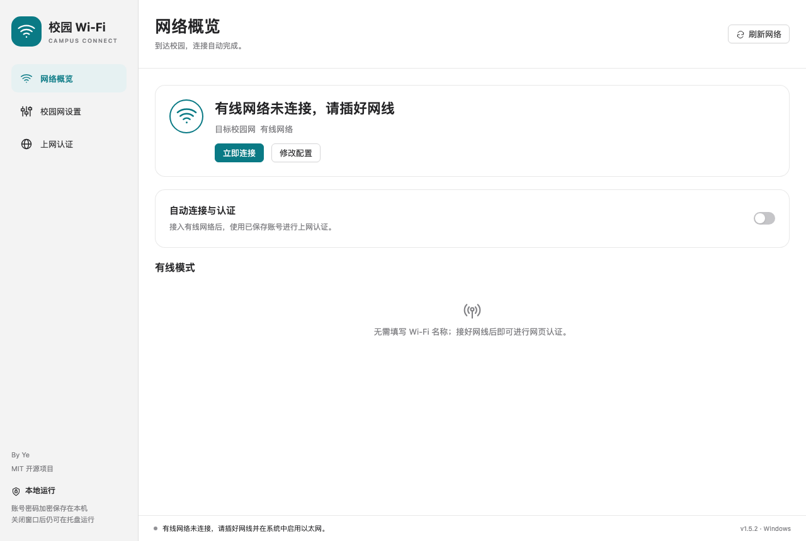

# 校园 Wi-Fi 助手 · CampusConnect

> 这个程序本来只是做给自己用的，奈何你们也想用。没办法，那就继续开发下去吧。

> [!IMPORTANT]
> **适配范围与交流反馈**
>
> 本程序目前已支持 **河南工业职业技术大学**、**郑州信息工程职业学院**、**无锡职业技术大学**、**天津石油职业技术学院** 的校园网认证，也欢迎其他学校的同学下载测试。
>
> 如果使用正常，欢迎在 [GitHub Issues](https://github.com/Ye9137/CampusConnect/issues) 中反馈 **学校名称**，帮助更多同学了解适用范围。
>
> 使用中如遇到连接或认证问题，请点击 **程序左下角的感叹号**，查看联系方式并联系作者。反馈时请提供 **学校名称** 和 **连接失败的完整视频**，方便排查问题、持续完善适配。

**CampusConnect 2.0.0 正式版**：[下载正式版](https://github.com/Ye9137/CampusConnect/releases/tag/v2.0.0) · [更新说明](2.0-更新说明.md)。Windows 与 macOS 均支持明确的 Wi-Fi / 有线选择、四种有线认证入口、网页必选框自动勾选和左下角问题反馈入口。

[](https://github.com/Ye9137/CampusConnect/actions/workflows/build.yml)
[](LICENSE)

由 [Ye9137](https://github.com/Ye9137) 维护，使用 MIT 许可证开源。

分别为 macOS 和 Windows 制作的桌面校园网连接工具。默认校园 Wi-Fi 为 `HNPI-STU`，认证地址为 `http://192.168.0.123`，可在设置中修改。

## 2.0 正式版

Windows 和 macOS 界面左下角提供「如果遇到问题请点击：!」入口。使用中如遇到问题，可点击感叹号查看联系方式并联系作者。

在 Windows 和 macOS 中，选择「有线网络（以太网）」后，可进一步选择网页认证、PPPoE 宽带拨号、802.1X 系统认证或学校专用客户端。旧版 Wi-Fi 名称留空的配置继续识别为有线模式；修改后需保存才会用于实际连接。有线模式的图标、窗口/托盘标题与提示已统一修正。

网页认证会自动勾选可识别的登录必选框和协议项，触发网页原有事件；勾选被拒绝或需要人工确认时停止自动提交。记住密码、推广订阅等可选项保留原状。

PPPoE、802.1X 需先在对应操作系统完成相应配置；专用客户端模式负责启动已安装的学校客户端，客户端内登录仍由客户端处理。macOS 的 802.1X 使用系统描述文件与自动连接，手动连接在系统网络设置中完成。平台差异与真实校园网络验证范围见 [更新说明](2.0-更新说明.md)。





## 1.5.0 正式版

- macOS 和 Windows 均支持填写网页中的完整服务选项名称；没有选项时留空。
- 登录后校验学校返回结果和已登录页面，按钮事件未触发时使用学校原有登录函数补充触发，避免重复提交。
- 联网状态统一使用 `ping www.baidu.com`。收到回应后显示“已经连接成功”，移除重复的 ping 成功日志；失败或超时判定未联网。
- 开启自动连接和自动提交时，未联网会按间隔重新认证；Wi-Fi 断开时重新连接。正在登录时等待本次结果，暂停设置继续有效。
- 清理已废弃的 HTTP 探测及相关状态、无效 Wi-Fi 失败计数和旧脚本标记。保留配置兼容、测试、诊断及第三方许可。

ping 使用系统路由，可能经过 VPN。Windows x64 与 macOS Apple 芯片 / Intel 通用包；Windows ARM64 可自行构建。平台实机验证范围见 [验证记录](VALIDATION.md)。

## 下载

**[Windows 2.0.0 安装包（x64）](https://github.com/Ye9137/CampusConnect/releases/download/v2.0.0/CampusConnect-Windows-x64-2.0.0-Setup.exe)** · **[macOS 2.0.0 通用版](https://github.com/Ye9137/CampusConnect/releases/download/v2.0.0/CampusConnect-macOS-universal-2.0.0.zip)** · [源码与校验文件](https://github.com/Ye9137/CampusConnect/releases/tag/v2.0.0)

## 2.0 正式版界面预览

以下为 Windows 2.0.0 界面预览，使用内置界面离线生成，展示未连接状态；账号、密码均为空。实际学校认证页面会在连接校园网后加载。

### 网络概览

查看校园 Wi-Fi 状态、附近网络，并控制自动连接。



### 校园网设置

配置校园 Wi-Fi、认证地址、账号信息和开机自启。服务选项按学校认证网页填写；网页没有选项时留空。



### 上网认证

打开学校认证页面，填写登录信息并检查上网状态。



### 有线模式

在「校园网设置」选择「有线网络（以太网）」和对应认证方式后保存。无需填写 Wi-Fi 名称或定位授权；网页认证填写学校认证信息，系统认证先完成相应系统配置。


网络概览会显示「有线网络」及当前状态。下图展示尚未连接网线时的提示。



## Windows 1.3.5 更新

默认打开的窗口内容区域增大为 1280 × 860，仍居中显示并可手动调整。

## 1.3.4 更新

- 侧边栏移入立即切换，去掉悬停延时与选中标记动画；右侧内容保留 280ms 推进效果。
- 校园 Wi-Fi 连着但认证失效时，持续检查真实上网状态并后台重新认证，避免只看 Wi-Fi 连接状态。
- 按实际学校 HTML / JavaScript 提前初始化认证表单，不再等待背景图片。等学校加密参数和服务信息齐备后立即填写和提交，仍使用学校自身的认证接口与加密逻辑。
- 验证码、运营商补充信息仍由用户处理；一次页面最多自动提交一次。


支持扫描校园 Wi-Fi、连接网络、网页认证、自动填写账号密码、后台自动重连。首次启动不含账号密码，自动连接默认关闭。

## 两个平台

| 版本 | 目录 | 运行方式 |
| --- | --- | --- |
| macOS 14+，Apple 芯片 / Intel 通用版 | [macOS](macOS/README.md) | 解压运行包，打开 `CampusConnect.app` |
| Windows 10/11 64 位 | [Windows](Windows/README.md) | 双击 `CampusConnect-Windows-x64-Setup.exe`，按向导安装 |

```text
macOS/
  source/                 Swift 原生应用源码、图标和构建脚本
  test.sh                 macOS 回归检查
Windows/
  source/                 C# / .NET 10 / WinForms / WebView2 源码
  tests/                  可跨平台运行的核心逻辑检查
  build.ps1               Windows 构建脚本
  installer/              中文安装向导、快捷方式、卸载及安装测试
  build-installer.ps1     Windows 安装包构建脚本
.github/workflows/        GitHub Actions 双平台构建
scripts/                  源码发布打包工具
```

本机构建后，Mac 应用位于 `macOS/CampusConnect.app`，Windows 单文件应用位于 `Windows/dist/win-x64/CampusConnect.exe`。构建产物不提交到源码仓库。

Windows 1.2 版将程序和 .NET 依赖合并，用户只需下载一个 Setup.exe 安装包。Windows 1.3.0 保留网络概览、校园网设置、上网认证三个页面，并增加开机自启。

Windows 安装版提供自定义安装目录、可选桌面快捷方式（默认勾选）、开始菜单入口、安装完成后运行，以及 Windows 设置中的卸载入口；卸载可选择是否删除账号配置。默认安装到当前用户目录，无须管理员权限。需要 WebView2 时会帮助安装，下载此组件需要联网。

## 使用

1. 打开对应系统版本；Wi-Fi 模式需要允许读取 Wi-Fi 名称的定位权限，有线模式无需此权限。
2. 在「校园网设置」填写认证网址和校园账号密码；Wi-Fi 模式填写网络名称，**有线模式将 Wi-Fi 名称留空**，保存。
3. 点击「立即连接」，在「上网认证」查看学校网页的结果。
4. 需要持续运行时，在设置中启用自动连接。关闭窗口后程序留在菜单栏 / 系统托盘；选择「退出」后停止。

自动连接每 20 秒检查一次，仅连接名称完全匹配且可见的 Wi-Fi；两次连接尝试至少间隔 60 秒。Windows 1.4.3 与 macOS 1.4.4 均持续按间隔重试，直到成功或用户暂停。每次打开认证页最多自动提交一次，避免反复提交错误密码。验证码、运营商选择或多步登录需在页面中手动完成。

认证信息只在已接入有线网络（有线模式）或当前 Wi-Fi 名称与设置匹配（Wi-Fi 模式），且网页协议 / 主机 / 端口与保存地址一致时自动填写。学校网页跳转到其他地址时，确认后更新设置再试。

## Windows 1.3.0

新增登录 Windows 后自动启动并留在托盘的独立开关；删除 Windows 网络诊断和运行记录页面；加入页面淡入及控件过渡，支持减少动态效果。左下角及安装器显示“By Ye · MIT 开源软件”。项目未新增或替换第三方组件的许可证。

安装器改用优先解压速度的 zlib 压缩，详情显示实际释放文件的名称、大小、目标目录及安装阶段。Windows 实际安装耗时和登录启动待下一次虚拟机开启后验证；源码包含相应 Windows 测试。

## Windows 1.2.4 性能优化

Windows 版将无线扫描、连接和 SSID 检查移到后台；启动时先显示缓存网络，再更新扫描结果。界面仅更新有变化且正在显示的列表，合并状态及认证页位置通知，并复用浏览器环境。启用 ReadyToRun 预编译后，继续保持单文件分发。这段记录描述 1.2.4 的改动；当前 Windows 和 macOS 均为 1.5.2。

## 1.2.3 认证页适配

支持锐捷 ePortal 的隐藏账号 / 密码输入框及图片式认证按钮。程序先通过页面焦点事件显示真实输入框，再填写并点击学校原有的认证控件；密码加密与认证参数仍由学校网页处理。按钮尚未就绪时短暂等待，实际提交最多一次。

如果之前手动填过高级 CSS 选择器，可清空三个选择器后使用自动识别。认证地址保存浏览器当前跳转得到的完整地址；重新连接后若旧链接失效，使用「探测认证地址」更新，不要仅截取 `/eportal/index.jsp`。

## 平台差异

| 功能 | macOS | Windows |
| --- | --- | --- |
| 开放 Wi-Fi + 网页认证 | 支持 | 支持 |
| 有线网络 + 网页认证（Wi-Fi 名称留空） | 支持 | 支持 |
| Wi-Fi 密码 / 企业认证 | 在应用设置中填写 | 先在 Windows 设置中连接并保存，应用复用系统配置 |
| 密码保存 | 用户目录本地文件，权限 600 | Windows 当前用户 DPAPI 加密 |
| 认证页面 | WebKit 临时会话 | WebView2 隐私会话，需要 WebView2 Runtime |
| 认证页直连 | 应用内代理按模式使用 Wi-Fi / 以太网 | 应用浏览器绕过显式 HTTP 代理；VPN 路由仍由 Windows 决定 |
| CPU | arm64 + x86_64 通用包 | 默认 x64，可另构建 ARM64 |

认证页无法访问时，可先完成校园认证再启用 VPN。本软件不会修改系统 VPN、DNS 或路由。它不保证自动适配所有学校的认证系统。

## 下载与源码

- [下载 Windows / macOS 运行包](https://github.com/Ye9137/CampusConnect/releases/latest)
- [浏览源码](https://github.com/Ye9137/CampusConnect)
- [报告问题或建议](https://github.com/Ye9137/CampusConnect/issues)

```sh
git clone https://github.com/Ye9137/CampusConnect.git
cd CampusConnect
```

安装包放在 Releases，源码仓库不包含个人配置、学校账号密码、浏览器数据、调试抓包或本地备份。

Actions 在推送到 `main` / `master`、提交 PR、推送 `v*` 标签或手动触发时检查并构建两个平台。完成后可在对应运行的 Artifacts 下载产物，Windows 同时构建 x64 和 ARM64。工作流不自动创建 Release。

Windows Actions 还会构建安装版，并在 x64 Windows 上检查单文件界面启动、自定义目录、快捷方式、重复安装、更换安装目录和卸载。校园 Wi-Fi 连接与真实认证仍需在学校网络中验证。

## 开发与验证

macOS 安装 Xcode Command Line Tools 后运行：

```sh
zsh macOS/test.sh
zsh macOS/source/build.sh
```

Windows 安装 .NET 10 SDK 后在 PowerShell 运行：

```powershell
dotnet run --project Windows/tests -c Release
powershell -ExecutionPolicy Bypass -File Windows/build.ps1
```

核心测试可在安装了 .NET 10 SDK 的 macOS / Linux 上运行；Windows 界面和无线接口必须在 Windows 上验证。

重新生成干净的源码包：

```sh
python3 scripts/package-source.py
```

验证范围详见 [验证记录](VALIDATION.md)。

## 依赖文档

- [Windows Native Wi-Fi API](https://learn.microsoft.com/en-us/windows/win32/nativewifi/portal)
- [Windows Wi-Fi 定位权限要求](https://learn.microsoft.com/en-us/windows/win32/nativewifi/wi-fi-access-location-changes)
- [Microsoft WebView2](https://learn.microsoft.com/en-us/microsoft-edge/webview2/)
- [.NET SDK 下载](https://dotnet.microsoft.com/download/dotnet/10.0)

## 许可证

本项目代码使用 [MIT 许可证](LICENSE)，允许使用、修改、分发和商业使用；分发时须保留版权声明和许可证。第三方依赖仍遵循各自的许可证，见 [第三方依赖说明](THIRD_PARTY_NOTICES.md)。

提交 Issue 或 Pull Request 前，请移除账号、密码、个人配置及带身份信息的认证地址。
